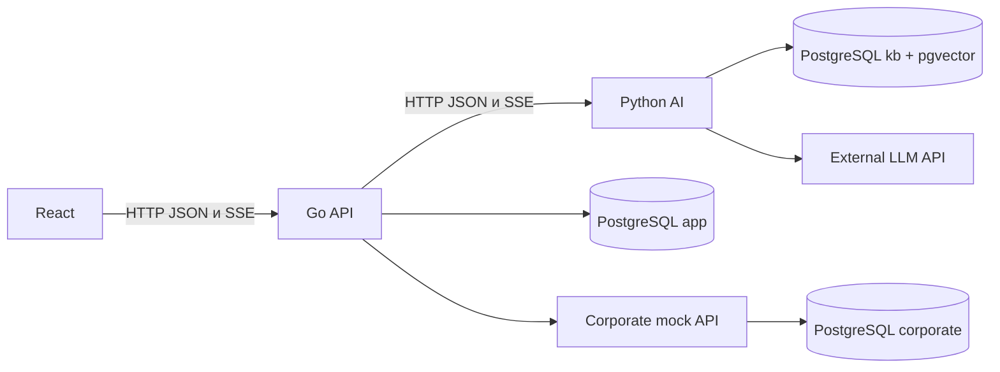

# Avito AI-buddy — System Architecture

Версия 1.1 · 2026-11-10 · базовая архитектура для старта команды; MVP ещё не реализован.
Scope: [продуктовая спецификация](docs/product/specification.md). Только intern и buddy.
HR и реальные корпоративные интеграции вне MVP.

## 1. Стек

| Область | Решение |
|---|---|
| Frontend | React + TypeScript, Vite, Tailwind CSS, TanStack Query, Zod |
| Локальное UI-состояние | React state; Zustand только при доказанной необходимости |
| Backend | Go, net/http, pgx/v5 для первой DB-фичи |
| AI | Python + FastAPI, psycopg3, внешний LLM API через adapter |
| Данные | PostgreSQL 17 + pgvector 0.8.2 |
| Интеграции | Отдельный corporate mock API; MCP вне первой версии |
| Запуск | Docker Compose; npm и uv lock-файлы |
| Проверки | Go testing, pytest/pytest-cov, Vitest/RTL, Playwright |

Runtime и зависимости: [development.md](docs/operations/development.md).
Провайдер LLM и embeddings не выбран: AI-01 в backlog. Mock mode не требует ключа.

## 2. Компоненты

APP/KB/CORP — схемы одной PostgreSQL. Браузер обращается только к Go через один origin.
Go хранит пользователей, роли, задачи, историю, runs, action proposals, заявки, обращения,
сессии, идемпотентность и аудит. Он авторизует объекты и подтверждения, исполняет действия.
Python получает разрешённый контекст от Go, ведёт знания/эмбеддинги, RAG, промпты,
LLM и предлагает tools. Он не читает app и не вызывает изменяющие состояние corporate API.
Mock владеет corporate; имитирует заявку и её статус, не выдаёт реальный доступ.

## 3. Потоки

1. Go проверяет сессию/владение диалогом и сохраняет user message + queued run.
2. Frontend открывает SSE run; Go атомарно начинает генерацию, передаёт разрешённый контекст AI.
3. Python отдаёт текст/источники и максимум одно предложение tool. Go проверяет и сохраняет
   assistant и pending action только после успешного окончания upstream.
4. Frontend показывает точные параметры, получает confirm конкретного действия.
5. Go повторно проверяет владельца, права, TTL и snapshot; исполняет идемпотентно и сохраняет результат.
6. Buddy получает только подтверждённый вопрос/summary. Ответ атомарно закрывает обращение.

Обрыв/отмена не означают успех; частичный ответ хранится с терминальным статусом.
SSE идёт Python → Go → frontend; обычные статусы обновляются polling раз в 5s.
Общий чат и один отдельный чат каждой задачи; buddy не получает историю стажёра.

## 4. Источники истины

- [decisions.md](docs/architecture/decisions.md): статус решений и изменение границ.
- [api-contracts.md](docs/architecture/api-contracts.md): маршруты, DTO и SSE.
- [v1.schema.json](contracts/v1.schema.json): проверяемые формы общих payload.
- [data-model.md](docs/architecture/data-model.md) и SQL-миграции: хранение и владельцы.
- [security.md](docs/architecture/security.md): сессии, CSRF, роли и контекст.
- [state-machines.md](docs/architecture/state-machines.md): статусы, повторы, ошибки.
- [ai-design.md](docs/architecture/ai-design.md): инструменты, RAG и AI-оценка.
- [docs/features/](docs/features/): SDD по четырём сценариям.

## 5. Качество и организация

Прикладное line coverage строго >80% отдельно для Go, AI, mock и frontend, включая
ветки ошибок и RBAC; E2E не заменяет component tests. До появления бизнес-логики
healthchecks не выдаются за покрытый MVP. Политика: [testing](docs/testing/strategy.md).
Feature-ветки, PR, review владельцев и TL для контрактов. Прямой push в main запрещён.
Backlog и правила: [team](docs/team/working-agreements.md).

## 6. Что ещё зависит от внешних решений

Имена/handles участников, provider/model/key/budget, live embeddings, место демонстрации,
исходники требований организаторов. Это открытые задачи, не молчаливые defaults.
Внешние приложения к первоначальному анализу были предложениями; решения данной версии
зафиксированы в рамках последующего поручения подготовить репозиторий к работе.
