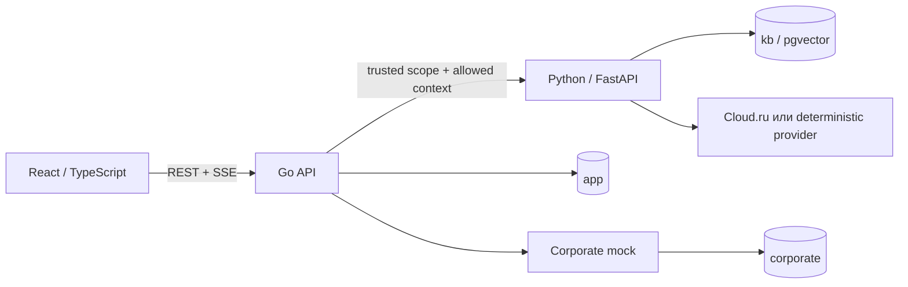

# Архитектура AI-buddy

## Компоненты и ответственность

React вызывает только Go, проверяет DTO через Zod и показывает server-owned
состояния. Go управляет сессиями/CSRF, авторизацией, goals/steps, actions, заявками,
evidence, blockers, friction, ТЗ/назначениями, версиями и review.
Python получает ограниченный контекст и готовит текст/структурированные предложения.
Он не пишет app/corporate и не исполняет корпоративные изменения.
Corporate mock — отдельный процесс, а не SQL-обход из AI.

Физическая PostgreSQL имеет схемы app, kb и corporate с отдельными владельцами
миграций и ограниченными runtime-ролями. Внутренняя БД приложения не является
тестовой БД, доступ к которой получает стажёр в пользовательском сценарии.

## Поток доступа и доверенные результаты

1. Версионированный JSON journey задаёт разрешённые шаги, зависимости и проверки.
2. Go вычисляет scope пользователя; AI видит только разрешённые документы и инструменты.
3. Action хранит неизменяемый preview, TTL и operation key. Стажёр подтверждает отправку.
4. Scoped согласующий отдельно принимает решение; mock IAM фиксирует grant.
5. Свежий IAM/DB результат, корреляция, версии и ownership проверяются Go в транзакции.
6. Только trusted evidence меняет verified. Ручной claim, AI-текст и Telegram click этого не делают.
7. Повторяющиеся нормализованные ошибки двух разных стажёров дают один candidate для review.

Повтор confirm/replay не создаёт второй side effect. Unknown outcome сверяется по прежнему
operation key; stale/edited/expired preview требует нового подтверждения. Отзыв доступа
инвалидирует зависимое evidence. Timeline — read model и не запускает проверку при чтении.

## ТЗ, обратная связь и AI-редактор

Published TaskBrief неизменяем, assignment закреплён за версией; принятие successor явно.
Техническая готовность goal и человеческая приёмка задания имеют разный смысл.
WorkspaceLink связывает только разрешённые сущности после preview/confirm.

Неясность ТЗ агрегируется отдельно от технической ошибки инструкции. Автор получает
report своего ТЗ/версии/раздела/reason без списка людей. Go резервирует revision proposal,
после commit вызывает AI без удержания app transaction и повторно валидирует ответ.
Generation token, revision, old_hash, TTL и ACL защищают от stale/late completion.
Выбранные изменения попадают только в draft; публикация — отдельное решение автора.

Impact рассчитывает Go: полные семидневные exposure episodes, разные участники,
подтверждённая сопоставимость разделов, distinct numerator/denominator, suppression.
Пагинация фиксирует snapshot/receipt cutoff; каждая страница и replay авторизуются заново.
Тестовые часы включаются только явным local/test config, публичного setter нет.

## AI, отказоустойчивость и стоимость

RAG сначала фильтрует ACL, затем ранжирует разрешённые chunks. Заголовки, metadata,
citations и повторное открытие источника также защищены. Go повторно валидирует sources.
Structured outputs имеют закрытые JSON-схемы; неизвестные пути, новые права/этапы,
инъекции, секреты и unsupported claims не становятся действиями.

Цепочка live: GigaChat-3-Pro → GigaChat3.5 → явно обозначенный offline provider.
Резервная модель вызывается до первого текста; после начала оборванный ответ помечается
interrupted. First-content guard попытки 6 с, общие first/idle/pipeline/Go пределы
20/25/85/90 с; heartbeat не продлевает content deadline. Circuit breaker — 30 с.
Повтор подключения допустим до отправки запроса, ошибки чтения не вызывают повтор оплаты.
Keep-alive и периодический GET /models поддерживают соединение без генерации текста.

Платные calls резервируют стоимость до запроса с hard output cap. Ledger хранится
в постоянном volume; unknown usage сохраняет резерв, restart не обнуляет расходы,
budget denial не запускает вторую платную модель. Тарифы и ключ задаются локально.

## Безопасность и эксплуатация

Role + team + resource + ownership + document ACL, deny by default. Нет произвольного
SQL/команд, финансовых операций или реальных данных сотрудников. Diagnostic preview
использует пересечение прав получателя/отправителя; агрегаты исключают raw logs/chat/PII.
Go SSE/history проходят через серверную проверку источников; UI account switch очищает
контекст прошлого subject. Сервисы используют непривилегированные runtime-роли.

Compose выполняет migrate → synthetic seed → ingest → readiness → API → UI.
Additive migrations и повторный seed сохраняют прогресс. Shutdown ожидает текущие
HTTP-запросы и after-commit работу перед закрытием пула БД.

[SDD](docs/sdd/README.md), [контракты](contracts/README.md), [тесты](docs/testing.md).
