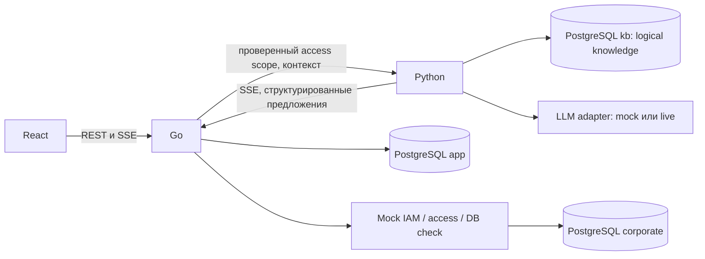

# Avito AI-buddy — System Architecture

Версия 2.0 · 2026-11-11 · целевая архитектура Engineering Onboarding & Feedback Loop.
[Product Spec](docs/product/specification.md), [основание](CODEX_PROJECT_REPLAN.md).
Runtime/DDL/seed v2 сведены в TL из авторских branches; API acceptance пройден,
browser/clean-build gates открыты. Источники и результаты — в TL record. BE+AI executable v2 contracts сведены в TL
checkout; final consumer acceptance еще открыт. См. [TL record](docs/team/tl-readiness.md).
Переход выполняется отдельными задачами: [TL baseline](docs/architecture/contract-baseline.md)
подготовлен, исполняемые schemas и consumer/final review ещё требуются. Эта редакция меняет документацию.

## 1. Сохранённый стек

| Область | Решение |
|---|---|
| Frontend | React + TypeScript, Vite, Tailwind CSS, TanStack Query, Zod; React state, Zustand только при необходимости |
| Backend | Go, net/http, pgx/v5; REST, RBAC + resource/document ACL |
| AI | Python + FastAPI, psycopg3, LLM adapter и RAG |
| Данные | PostgreSQL 17 + pgvector 0.8.2, одна БД с разделением схем |
| Инфраструктура | Docker Compose, GitHub Actions, npm/uv locks; offline/mock provider |
| Тесты | Go testing, pytest/pytest-cov, Vitest/RTL, Playwright |

Версии из manifests: [development](docs/operations/development.md). Один ограниченный
AI-помощник; MCP и multi-agent платформа не требуются.

## 2. Границы и источники истины

React отвечает за интерфейс и отправляет запросы только Go. Go владеет auth, разрешениями,
шаблонами и Goal/Step, зависимостями, evidence, blockers, проверками, историей, actions,
заявками, friction events, эскалациями, candidate/review, аудитом и идемпотентностью.
Go вычисляет доступность и переходы; LLM не является движком графа или источником verified.

Python владеет знаниями/ACL-метаданными/фрагментами/эмбеддингами, prompting, выбором
разрешённого маршрута, объяснением, AI draft, классификацией, handoff и candidate draft.
Он не читает app/corporate и не пишет бизнес-состояние. AI Engineer определяет внутреннюю
реализацию в этих границах, TL согласует интерфейсы и безопасность.

Mock corporate — отдельный процесс, сохраняющий synthetic IAM/grants, approvals и DB checks.
Схема corporate сохраняет существующего владельца mock_service; только Go вызывает
изменяющие mock-операции. Это выбранный в brief вариант отдельной схемы, без передачи
Python бизнес-владения. Логическое имя knowledge из brief соответствует существующей
физической схеме `kb`: переименование без продуктовой необходимости не планируется (ADR-024).
Тестовая БД сценария — синтетический ресурс mock, не внутренняя PostgreSQL приложения.

## 3. Основной поток

1. Go аутентифицирует пользователя и выдаёт только разрешённые версии JSON-маршрутов.
   Начало Goal фиксирует версию и шаги; валидатор исключает циклы, неизвестные проверки и права.
2. Go проверяет IAM. При отсутствии grant создаёт blocker и передаёт AI разрешённый контекст.
3. Python заполняет draft. Go валидирует поля, связывает actor/resource/goal, сохраняет
   неизменяемое pending action. React показывает точный preview; intern подтверждает отправку.
4. Go создаёт mock-заявку с operation key. Отдельная уполномоченная роль принимает решение
   через Go; mock IAM фиксирует grant, Go проверяет его повторным чтением.
5. Безопасный DB check возвращает trusted result. Go атомарно сохраняет check/evidence,
   пересчитывает шаги, создаёт blocker/friction при ошибке. Произвольный SQL запрещён.
6. Handoff проходит preview и confirm; buddy получает только разрешённый обоим snapshot.
   Его ответ закрывает обращение, но результат цели требует новой проверки.
7. Go считает distinct interns по journey_id + step_id + error_code в разрешённой области.
   При пороге 2 резервирует уникальный candidate; Python готовит гипотезу, Go валидирует
   и сохраняет её. При недоступности AI остаётся детерминированная карточка для review.
8. Ответственный рассматривает candidate. Accepted не меняет инструкцию. Resolved требует
   ссылки на проверенную человеком новую версию документа/маршрута, без автоматической публикации.

## 4. Безопасность и восстановление

Role + team + resource grant + document ACL + ownership определяют доступ, deny by default.
Scope вычисляет Go, Python применяет его до retrieval/LLM, повторно проверяет citations.
Названия/ссылки также защищены; при отзыве прав старый source не открывается.
Диагностика использует safe codes, не DSN/логи/персональные данные. Агрегат не содержит
идентификаторов людей; внутренний distinct-count хранится в app.

Сессии/cookie/Origin/CSRF сохраняются. Action TTL, идемпотентность, unknown/reconcile,
version conflict и транзакционные переходы обязательны. SSE Python → Go → React относится
к AI; бизнес-события — отдельный серверный журнал. После разрыва клиент читает REST,
не исполняет действие повторно. Poll 5s в активной вкладке, mock approval не вызывается таймером.

## 5. Контракты и реализация

[ADR](docs/architecture/decisions.md), [API](docs/architecture/api-contracts.md),
[events](docs/architecture/event-contracts.md), [journey template](docs/architecture/journey-template.md),
[data model](docs/architecture/data-model.md), [states](docs/architecture/state-machines.md),
[security](docs/architecture/security.md), [AI](docs/architecture/ai-design.md),
[SDD](docs/features/README.md) описывают один target v2.
[contracts](contracts/README.md) описывает отставание исполняемой схемы v1 от target v2.
Нельзя реализовать новый UI на старом TaskStatus или считать старый seed новым демо.
Контракты и новые миграции обновляются синхронно в RP-CONTRACT-01/RP-DATA-01.

## 6. Качество и организация

Line coverage строго >80% для каждого прикладного компонента; каркас без бизнес-логики
остаётся BOOTSTRAP, не покрытым MVP. [Testing](docs/testing/strategy.md) связывает
приёмку с P0. Публикация и PR — только владелец репозитория. Агент работает локально
в назначенной текущей ветке, не создаёт/не переключает ветки. [Backlog](docs/team/backlog.md)
задаёт недельную интеграцию. [Назначения](docs/team/assignments/README.md) и
[contract handoff](docs/team/contract-handoff.md) фиксируют актуальные роли/следующие действия;
[audit](docs/team/replan-audit.md) сохраняет исторический отчёт перепланирования.
