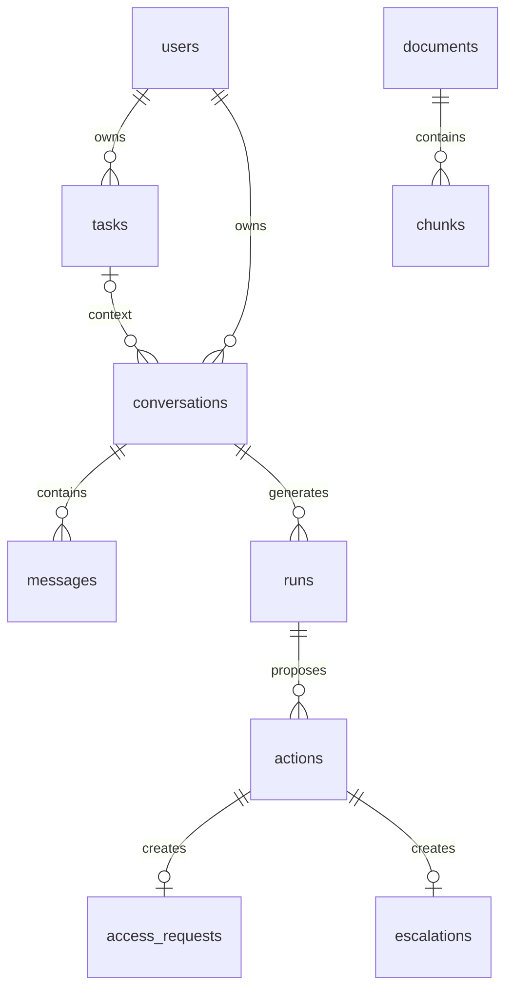

# Модель данных v1

Исполняемая база: [app migration](../../backend/migrations/001_initial.sql),
[kb migration](../../ai-service/migrations/001_initial.sql),
[corporate migration](../../mock-services/migrations/001_initial.sql).
DDL — источник истины для колонок и ограничений, API — для внешнего DTO.

| Схема | Владелец миграций | Runtime role | Объекты |
|---|---|---|---|
| app | Go / app_owner | app_service | users, sessions, tasks, conversations, messages, runs, actions, access_requests, escalations, audit_events, idempotency_keys |
| kb | AI / kb_owner | ai_service | documents, chunks, index_metadata |
| corporate | Mock / corporate_owner | mock_service | access_requests |

No-login owners создаются bootstrap, runtime roles не получают DDL и чужих схем.
Административная роль используется только bootstrap/migrate/seed, не приложением.
Связи между схемами — UUID в API, без cross-schema FK и прямых JOIN.

У стажёра один buddy из users; runtime проверяет role обеих сторон. Задача принадлежит одному
стажёру. Для conversation(task_id,intern_id) связь составная: чужая задача невозможна.
Один общий диалог и один task-диалог обеспечены partial unique indexes.
Для внешних ключей и списков владельцев есть индексы. Даты timestamptz, UUID создаёт приложение.
updated_at обновляет приложение в той же транзакции; optimistic version у tasks.
ID источников в JSON должны валидироваться Go через AI API; SQL не обеспечивает ACL.
Критические action transitions блокируют SELECT FOR UPDATE/условным UPDATE.
Ответ buddy и resolved_at записываются одной транзакцией.

## Миграции

`make migrate` применяет SQL по номеру в каждой схеме; runner берёт advisory lock,
переключается SET LOCAL ROLE, ведёт schema_migrations с SHA-256 и применяет файл транзакционно.
Повторный запуск пропускает применённые файлы, изменение checksum — ошибка.
Порядок app → kb → corporate; общие роли/extension создаёт bootstrap до миграций.
Новые изменения только новыми SQL-файлами. Откат в MVP — исправляющая миграция;
пересоздание local volume допустимо только явным `make reset` с предупреждением о потере данных.

## Знания

Все документы помечены synthetic=true и visibility=demo_public. В seed есть исходные документы,
но нет псевдоэмбеддингов. kb.chunks.embedding — vector без фиксированной размерности;
пустой индекс не является готовым RAG. После AI-01 новая миграция фиксирует размерность,
имя модели и ANN-индекс; загрузчик отказывает при несовместимой модели/размерности.
У документа есть version и content_hash; повторная индексация заменяет chunks атомарно.

## Seed и жизненный цикл

`make seed` загружает [demo.json](../../data/seed/demo.json) и [knowledge](../../data/knowledge/).
Seed идемпотентен по ID, не перезаписывает прогресс и ответы; изменённый контент существующего
документа не обновляет незаметно индекс — нужен явный reindex AI. Реальный reset удаляет volume.
Есть две независимые пары intern/buddy для негативных тестов доступа.
История сохраняется до reset локального demo. Работа с реальными данными вне scope.
